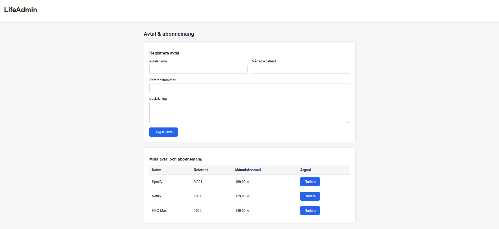

# LifeAdmin – Agreements & Subscriptions

LifeAdmin is a full-stack web application developed as a school project during my Frontend Developer studies at EC Utbildning in Sweden.

The application provides a simple way to manage agreements and subscriptions, with a focus on understanding how frontend development, backend APIs, and database operations work together.

## Screenshot



## Features

- Add new agreements with a name, monthly cost, reference number, and description.
- Automatically load saved agreements when the page opens.
- Delete existing agreements.
- Update the agreement table dynamically without refreshing the page.
- Validate form inputs on both the client and server.
- Display error messages when API requests fail.
- Store agreements persistently using SQLite.
- Format monthly costs according to Swedish currency conventions.

## Tech Stack

**Frontend**

- HTML5
- CSS3
- Vanilla JavaScript
- DOM manipulation
- Fetch API

**Backend**

- Node.js
- Express.js
- SQLite (built-in `node:sqlite` module)
- REST-style API endpoints

**Version Control**

- Git
- GitHub

## API Endpoints

| Method | Endpoint              | Description               |
| ------ | --------------------- | ------------------------- |
| GET    | `/api/agreements`     | Retrieve all agreements   |
| POST   | `/api/agreements`     | Create a new agreement    |
| DELETE | `/api/agreements/:id` | Delete an agreement by ID |

## Getting Started

### Prerequisites

- Node.js 24 or a compatible version supporting `node:sqlite`
- npm

### Installation

1. Clone this repository.
2. Navigate to the project directory.
3. Install dependencies:

   ```bash
   npm install
   ```

4. Start the development server:

   ```bash
   npm run dev
   ```

   Alternatively, start the server without Nodemon:

   ```bash
   npm start
   ```

5. Open the application in your browser:

   `http://localhost:8000`

The SQLite database and its required table are created automatically when the server starts.

## Project Structure

```text
LifeAdmin/
├── public/
│   ├── index.html
│   ├── style.css
│   └── app.js
├── src/
│   └── server.js
├── .gitignore
├── package.json
└── package-lock.json
```

## What I Learned

This project gave me practical experience with:

- Manipulating the DOM using JavaScript.
- Sending asynchronous HTTP requests with the Fetch API.
- Building API endpoints with Express.
- Working with GET, POST, and DELETE requests.
- Using SQL queries and SQLite for persistent data storage.
- Validating user input and handling API errors.
- Connecting frontend and backend functionality.
- Using Git for version control.

## About This Project

This application was created as part of the _JavaScript in the Browser_ course at EC Utbildning.

It is a learning project built with vanilla JavaScript, Node.js, Express, and SQLite, without frontend frameworks.

The application interface is in Swedish, while the project documentation is in English.
